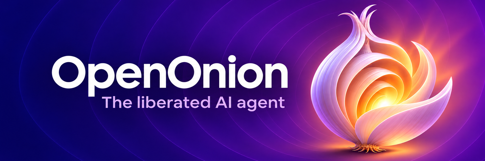
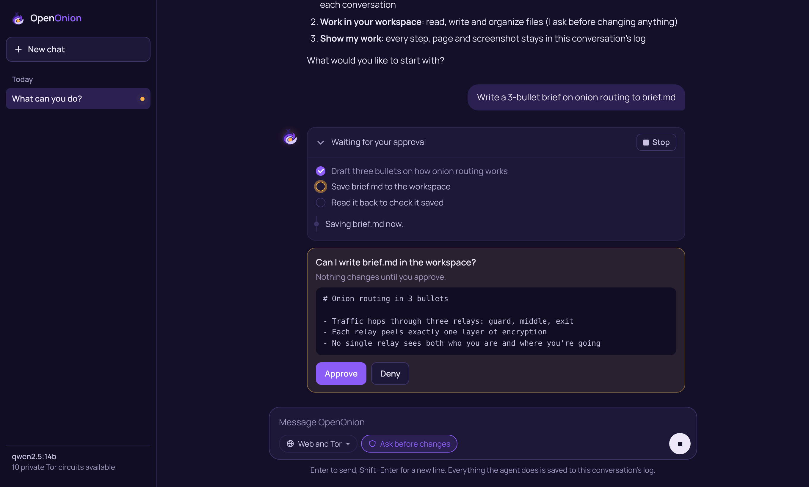
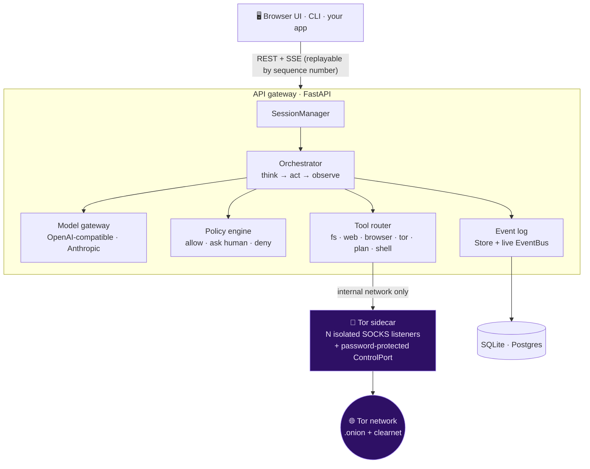
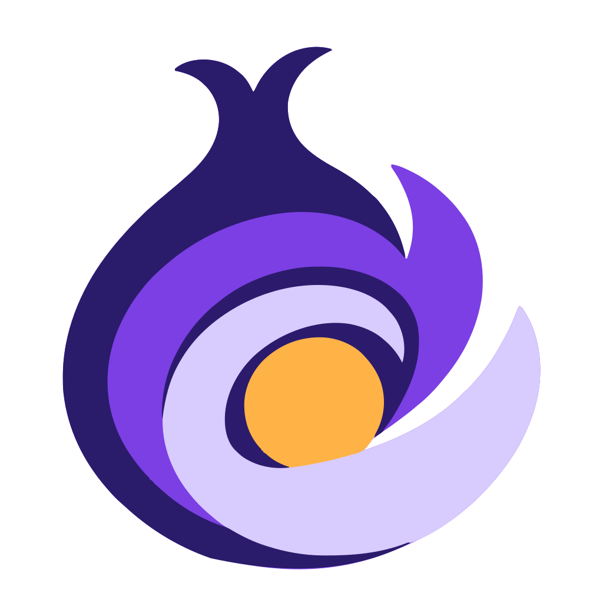

<div align="center">

<a href="https://github.com/brandononchain/openonion">
  
</a>

<h3>An open-source AI agent you host yourself, point at any model, and watch while it browses the web over Tor.</h3>

<p>
  <a href="https://github.com/brandononchain/openonion/actions/workflows/ci.yml"></a>
  <a href="LICENSE"></a>
  
  
  <a href="#-quick-start"></a>
  <a href="docs/tor-threat-model.md"></a>
  <a href="CONTRIBUTING.md"></a>
</p>

<p>
  
  
  
  
  
  
  
  
</p>

<p>
  <a href="#-quick-start"><b>Quick start</b></a> ·
  <a href="#-how-it-works"><b>How it works</b></a> ·
  <a href="#-tools"><b>Tools</b></a> ·
  <a href="#-api"><b>API</b></a> ·
  <a href="docs/architecture.md"><b>Architecture</b></a> ·
  <a href="docs/tor-threat-model.md"><b>Threat model</b></a> ·
  <a href="#-roadmap"><b>Roadmap</b></a>
</p>

</div>

---

OpenOnion runs a transparent **think → act → observe** loop. Every thought, plan revision, tool call, approval and
result is an append-only event you can watch live, replay, export, and audit. There's no hidden orchestration,
no lock-in, and no closed infrastructure. Swap the model, the database, or the tools without touching the agent.

<div align="center">
  <picture>
    <source media="(prefers-color-scheme: dark)" srcset=".github/assets/screenshot-dark.png">
    <source media="(prefers-color-scheme: light)" srcset=".github/assets/screenshot-light.png">
    
  </picture>
  <br>
  <sub>Talk to it like a chat. When a request needs tools, the agent shows its plan and each step as it works, and asks before it changes anything.</sub>
</div>

## ✨ Highlights

<table>
  <tr>
    <td width="50%" valign="top">
      <h4>🔌 Provider-agnostic</h4>
      Any OpenAI-compatible endpoint (Ollama, vLLM, LM Studio, OpenRouter, OpenAI and others) or the Anthropic API. Run a local model to keep every token on your own hardware.
    </td>
    <td width="50%" valign="top">
      <h4>🧅 Tor browsing done carefully</h4>
      Each session gets its own Tor listener, so its circuits are never shared with another session. DNS for every hostname, <code>.onion</code> included, resolves inside Tor. WebRTC and QUIC side channels are closed. Circuits rotate on demand.
    </td>
  </tr>
  <tr>
    <td valign="top">
      <h4>🔍 Transparent by construction</h4>
      The event log is the source of truth. Watch it stream live over SSE, export any session as JSON Lines, and resume it with a follow-up goal.
    </td>
    <td valign="top">
      <h4>🛡️ Safe by architecture</h4>
      A per-session policy decides <b>allow / ask a human / deny</b> for every tool call. File access is jailed to the session workspace, SSRF protection blocks private hosts, and tool output is labelled as untrusted data.
    </td>
  </tr>
  <tr>
    <td valign="top">
      <h4>📦 Self-hostable</h4>
      One <code>docker compose up</code> starts the API, a Tor sidecar and Postgres. Or run it straight from Python with SQLite.
    </td>
    <td valign="top">
      <h4>🧩 Small and hackable</h4>
      The orchestrator is about 250 readable lines. Providers, tools, the store and the browser each sit behind a small interface you can replace.
    </td>
  </tr>
</table>

## 🚀 Quick start

### Docker (recommended)

```bash
git clone https://github.com/brandononchain/openonion.git && cd openonion
cp .env.example .env
#  1. pick a model provider in .env (Ollama on your host works out of the box)
#  2. set TOR_CONTROL_PASSWORD:  openssl rand -hex 24
docker compose up --build
```

Open **http://127.0.0.1:8000**, type a goal, and pick a network mode. You'll see the agent plan and act, and it'll ask before it writes files.

Check that traffic really exits through Tor:

```bash
docker compose exec api openonion tor-check
# bootstrap: 100%
# SOCKS tor:9100 → IsTor=True exit IP=185.x.x.x
```

### Local Python (no Docker)

```bash
pip install -e ".[browser,dev]"
playwright install chromium
export OPENONION_PROVIDER=openai OPENONION_BASE_URL=http://localhost:11434/v1 OPENONION_MODEL=qwen2.5:14b
# Optional Tor: run a local tor with `SocksPort 9050` and `ControlPort 9051` + HashedControlPassword
export TOR_SOCKS_PORTS=9050 TOR_CONTROL_PASSWORD=...

openonion serve                      # web UI + API on 127.0.0.1:8000
openonion run "Summarize the front page of the Tor Project's onion site" --network tor
```

<details>
<summary><b>CLI reference</b></summary>

| Command | What it does |
|---|---|
| `openonion serve` | Start the web UI and API on `127.0.0.1:8000` |
| `openonion run "<goal>" --network tor` | Run a goal in the terminal and stream events as they happen |
| `openonion export <session-id>` | Print a session's full event log as JSON Lines |
| `openonion tor-check` | Confirm Tor bootstrap and that traffic exits through Tor |

</details>

## 🧠 How it works



1. You give a session a goal. The orchestrator sends the model the goal, the full prior transcript, and the tool schemas.
2. The model keeps a visible plan with `update_plan` and acts through tool calls.
3. Each call is validated against its typed schema, then checked by the session's policy. Gated tools pause until you approve or deny them in the UI or CLI.
4. Results go back to the model wrapped in `<tool_output trust="untrusted">`. Screenshots and files become artifacts.
5. The run ends when the model answers without tools, or when a step, tool-call or token budget runs out.

📐 Design notes: [docs/architecture.md](docs/architecture.md) · 🧅 Tor threat model: [docs/tor-threat-model.md](docs/tor-threat-model.md)

## 🧰 Tools

| Tool | What it does | Default policy |
|---|---|---|
| `update_plan` | Create or revise the visible plan | always allowed |
| `read_file`, `list_files` | Read the session workspace | allow |
| `write_file` | Write into the session workspace | **ask** |
| `web_fetch` | Fast clearnet HTTP fetch → main content as markdown; re-checks policy on every redirect, blocks private IPs | allow (clearnet modes) |
| `browse` | Headless Chromium on the clearnet, JS + screenshot → main content as markdown | allow (clearnet modes) |
| `tor_browse` | Headless Chromium through this session's own Tor circuits; `.onion` supported → main content as markdown | allow (tor modes) |
| `tor_new_identity` | `SIGNAL NEWNYM`: fresh circuits | allow (tor modes) |
| `run_shell` | Bash in the workspace. **Off** unless `OPENONION_ENABLE_SHELL=true` | **ask** |

### Reading the web without flooding the context

Every page tool runs the same simplifier ([`readable.py`](src/openonion/readable.py), standard library only):

- **Keeps the main content.** It uses `<main>`, `role=main` or the page's `<article>`, and drops navigation, headers, footers, sidebars, forms, cookie banners, modals, share bars and ads.
- **Removes what a human can't see.** That covers `display:none`, `visibility:hidden`, zero opacity, off-screen and zero-size text, plus `hidden` and `aria-hidden`. Hidden text is a common prompt-injection channel. The screenshot is taken first, so it still shows the page as rendered.
- **Returns compact markdown.** Headings, lists, tables, quotes and code survive. Links become `[L3]` references, and their URLs are listed once under the text.
- **Pages through long content.** Results come in 12k-character chunks, and the agent reads on with `offset`. The page is cached for the session, so paging never refetches it over Tor.

> [!TIP]
> Add your own tool by subclassing `openonion.tools.base.Tool` (a pydantic `Args` model plus `async run()`) and registering it.

## 🛡️ Session policy

Every session carries a policy, set when you create it. The model can't see it or change it.

```jsonc
{
  "network": "both",                 // off | clearnet | tor | both
  "approval_required": ["write_file", "run_shell"],
  "allowed_tools": null,             // or a whitelist, e.g. ["tor_browse", "write_file"]
  "clearnet_allowlist": [],          // e.g. ["wikipedia.org"]; empty = any public host
  "tor_allowlist": [],
  "javascript": true,
  "max_steps": 25, "max_tool_calls": 60, "max_total_tokens": 400000
}
```

## 🔗 API

| Method & path | Purpose |
|---|---|
| `POST /api/sessions` | Create a session `{title, policy, goal?}`; a `goal` starts the first run immediately |
| `GET /api/sessions` · `GET /api/sessions/{id}` | List / inspect (incl. `running`, `pending_approvals`) |
| `POST /api/sessions/{id}/runs` | Start a (follow-up) run `{goal}` |
| `POST /api/sessions/{id}/approvals/{approval_id}` | `{approved: true\|false}` |
| `POST /api/sessions/{id}/cancel` | Stop the active run |
| `GET /api/sessions/{id}/stream?after=N` | Live SSE; resumes from `Last-Event-ID`; `follow=false` replays and closes |
| `GET /api/sessions/{id}/events?after=N` | Event log page (JSON) |
| `GET /api/sessions/{id}/export` | Full log as JSON Lines (includes the model transcript) |
| `GET /api/sessions/{id}/artifacts` · `GET /api/artifacts/{id}` | Screenshots and other outputs |

Set `OPENONION_API_TOKEN` to require `Authorization: Bearer <token>` (or `?token=` for EventSource).

<details>
<summary><b>Example: start a Tor-only session with curl</b></summary>

```bash
curl -s http://127.0.0.1:8000/api/sessions \
  -H 'content-type: application/json' \
  -d '{"title": "onion news", "goal": "Summarize what is new on the Tor Project onion site", "policy": {"network": "tor"}}'
```

</details>

## ⚙️ Configuration

| Variable | Default | Notes |
|---|---|---|
| `OPENONION_PROVIDER` | `openai` | `openai` (any compatible endpoint) or `anthropic` |
| `OPENONION_MODEL` | — | Required for `openai` |
| `OPENONION_BASE_URL` | `https://api.openai.com/v1` | e.g. `http://localhost:11434/v1` for Ollama |
| `OPENONION_API_KEY` / `ANTHROPIC_API_KEY` | — | |
| `DATABASE_URL` | SQLite in the data dir | `postgresql+asyncpg://…` for Postgres |
| `OPENONION_DATA_DIR` | `./data` | Workspaces, artifacts, SQLite |
| `TOR_SOCKS_HOST` / `TOR_SOCKS_PORTS` | `127.0.0.1` / `9050` | A range like `9100-9109` gives 10 concurrent isolated sessions |
| `TOR_CONTROL_HOST` / `TOR_CONTROL_PORT` / `TOR_CONTROL_PASSWORD` | `127.0.0.1` / `9051` / — | Needed for `tor_new_identity` and `tor-check` |
| `OPENONION_API_TOKEN` | — | Enables API auth |
| `OPENONION_ENABLE_SHELL` | `false` | Registers `run_shell` |

## 🗂️ Project layout

```text
openonion/
├── src/openonion/
│   ├── runtime/        # orchestrator loop, session manager, per-session services
│   ├── providers/      # OpenAI-compatible, Anthropic, scripted (tests & evals)
│   ├── tools/          # typed tools: fs, web, browser, tor, plan, shell
│   ├── browser/        # Playwright service + Tor port pool & control client
│   ├── memory/         # async SQLAlchemy store (SQLite / Postgres)
│   ├── api/            # FastAPI app: REST, SSE replay, export, auth
│   ├── web/            # dependency-free chat UI, favicons, bundled font
│   ├── policy.py       # SessionPolicy + PolicyEngine
│   ├── events.py       # event types + fan-out bus
│   └── cli.py          # `openonion` command
├── infra/docker/tor/   # hardened Tor sidecar image
├── tests/              # pytest suite
├── docs/               # architecture + Tor threat model
├── brand/              # logos, icons, social banners, usage guide
├── Dockerfile
└── docker-compose.yml
```

## 🧪 Development

```bash
make install   # pip install -e ".[dev,browser]" && playwright install chromium
make test      # pytest -q
```

The suite covers the orchestrator loop and budgets, approvals, cancellation and transcript repair, policy and SSRF rules,
the filesystem jail, both provider wire formats, and the Tor control protocol. It also covers the API and SSE replay,
plus a browser test that proves hostnames are never resolved locally when browsing through Tor.

Contributions are welcome. Start with [CONTRIBUTING.md](CONTRIBUTING.md).

## 🗺️ Roadmap

- [x] **Phase 1: core agent.** Transparent loop, event log with SSE replay, policy engine, per-session Tor isolation, web UI.
- [ ] **Phase 2: subagents.** Research, coding, browser and validation subagents with handoff contracts.
- [ ] **Phase 3: skills and plugins.** `SKILL.md` task contracts, and MCP servers as tool backends.
- [ ] **Phase 4: multi-agent workflows.** Parallel DAGs, a shared artifact store, signed action receipts.
- [ ] **Hardening.** Per-session gVisor or microVM sandboxes for `run_shell`, a Tor Browser–grade fingerprint profile (Firefox + `resistFingerprinting`), and a queue-backed runner for horizontal scale.

## ⚖️ Responsible use

> [!IMPORTANT]
> OpenOnion hides *where* the agent connects from. It doesn't make *what the agent does* legitimate. You're responsible
> for complying with the laws that apply to you and with the terms of the services you access. Headless Chromium over
> Tor is **IP-anonymized, not anonymous**. Read the [threat model](docs/tor-threat-model.md) before relying on it.

Found a vulnerability? Please report it privately. See [SECURITY.md](SECURITY.md).

## 🎨 Brand

Logos, icons, social banners, colors and usage rules live in [`brand/`](brand/README.md).

## 📄 License

Released under the [Apache License 2.0](LICENSE).

<div align="center">
  <br>
  
  <br>
  <sub>Built in the open. If OpenOnion is useful to you, a ⭐ helps others find it.</sub>
</div>
